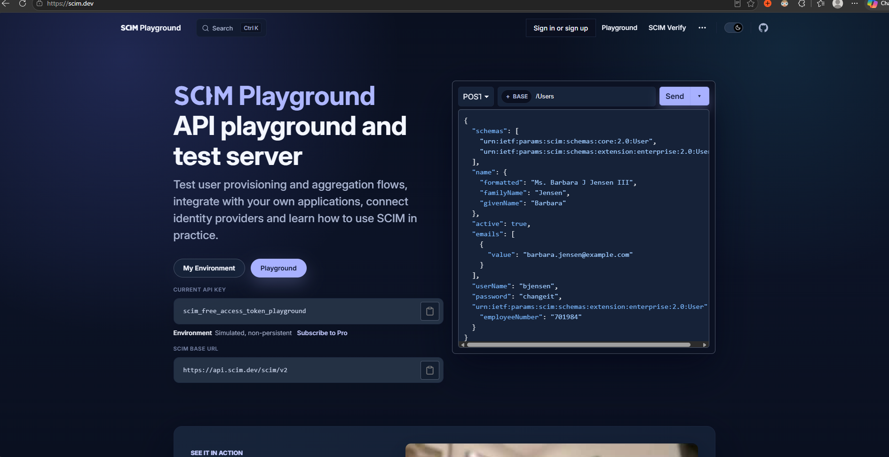
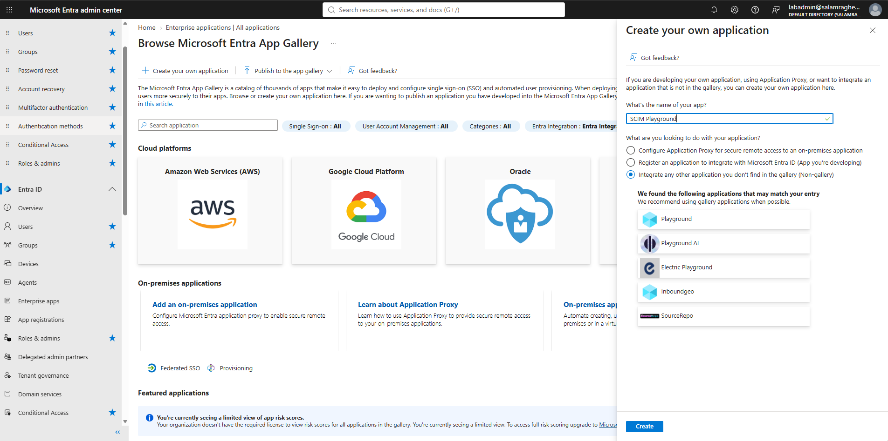
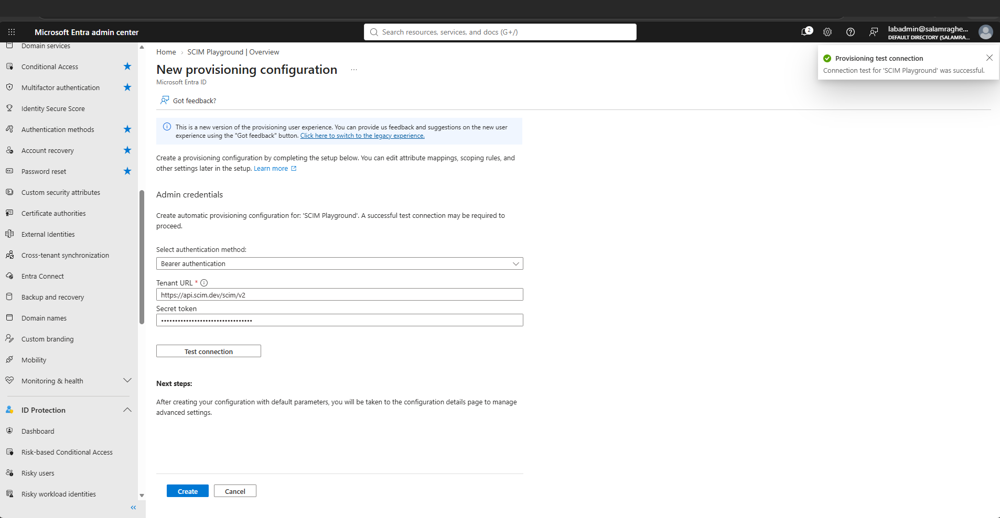
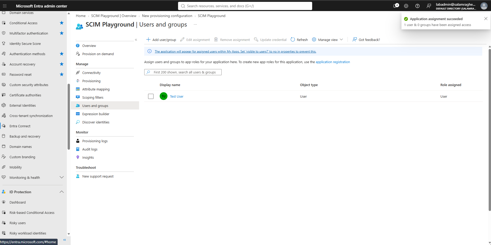
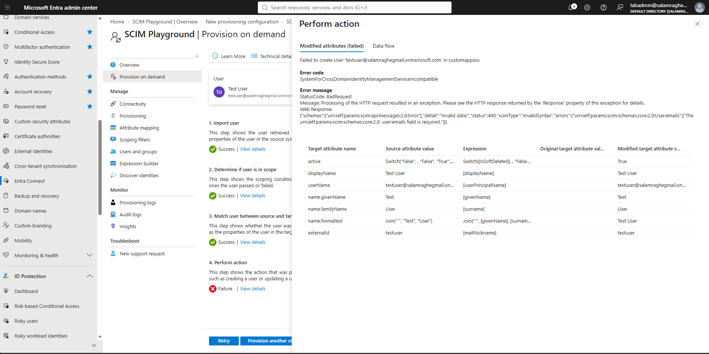
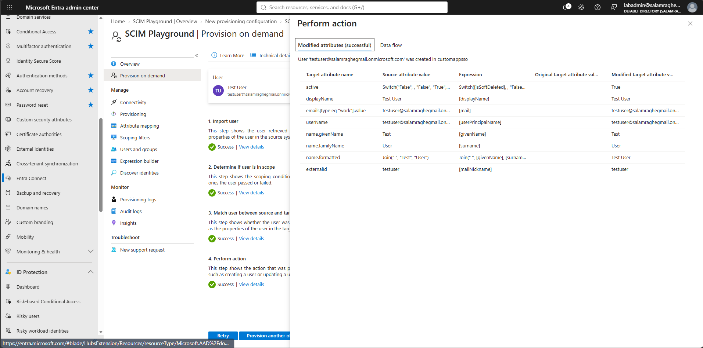
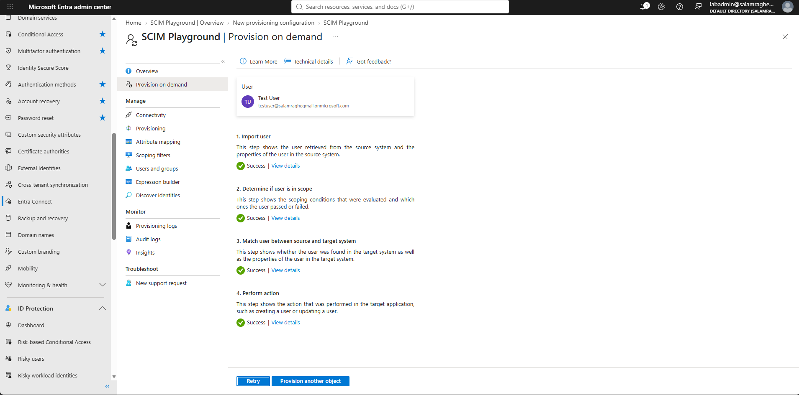
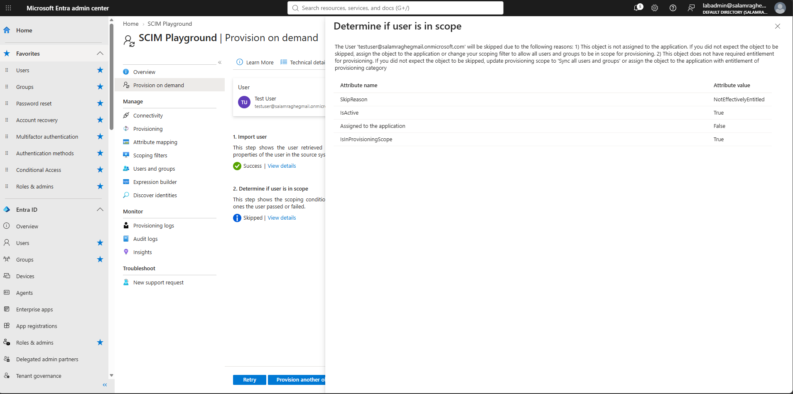
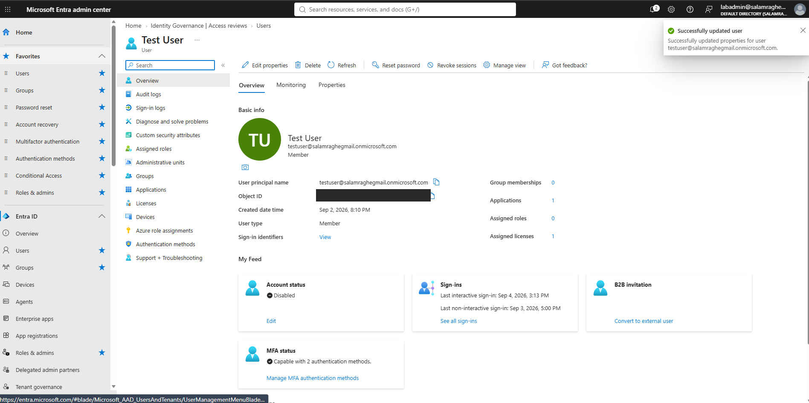
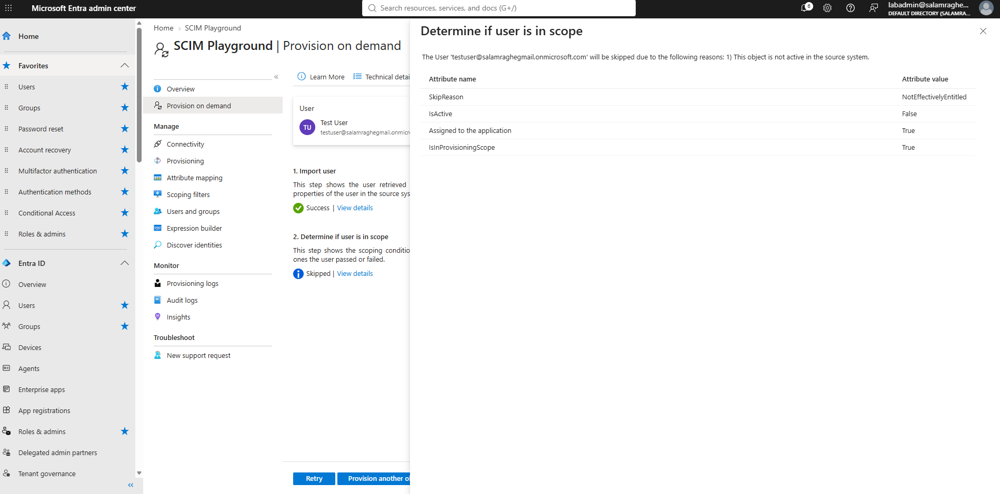

# Entra ID SCIM Provisioning (to scim.dev)

Hands-on lab, October 2026.

## What this is and why it matters

SCIM lets Entra create and turn off accounts in apps automatically. I connected an app to Entra, assigned Test User, and Entra created their account in the app by itself. It failed at first because the app needed an email and Test User didn't have one, so I added the email and retried. Then I disabled Test User in Entra, and Entra flagged them to be shut off in the app too.

This is how companies stop doing app accounts by hand: the identity provider becomes the source of truth, so joiners get accounts and leavers lose them without someone remembering every app.

## Environment

| Item | Value |
| --- | --- |
| Identity provider | Microsoft Entra ID (lab tenant) |
| Target app | **SCIM Playground** at [scim.dev](https://scim.dev) (free test server) |
| Tenant URL | `https://api.scim.dev/scim/v2` |
| Auth | Bearer token (scim.dev's public free playground key; masked in Entra) |
| Test user | Test User |

## Steps

### 1. scim.dev free playground endpoint

### 2. Create a non-gallery enterprise app: "SCIM Playground"

### 3. Provisioning: Bearer auth + tenant URL, test connection succeeded

### 4. Assign Test User to the app

### 5. Provision on demand: first try failed (see "What broke")

### 6. Retry after adding the email: user created in the app

All 4 steps succeeded, and Entra sent `emails[type eq "work"].value`, `userName`, `name`, `active = True` and `externalId`.

### 7. Scope check: an unassigned user is skipped

When Test User wasn't assigned to the app, Entra skipped them (`Assigned to the application: False`, `NotEffectivelyEntitled`). Only assigned users get accounts.

### 8. Leaver: disable Test User in Entra

Provision on demand now shows `IsActive: False` while `Assigned to the application: True`, meaning "not active in the source system." Entra flags the user to be shut off in the app.

## What broke and how I fixed it

- **First provision failed at step 4 (Perform action):** `400 invalidSyntax: urn:ietf:params:scim:schemas:core:2.0:User:emails field is required`. The app required an email and Test User didn't have one. I added the email to Test User and retried, and the user was created.

## Honest note

scim.dev's free playground resets its data, so I couldn't show the account flipped to inactive on the app side. The shut-off is shown on the Entra side instead (`IsActive False`, still assigned).

## Skills shown

- **IAM Support:** assigning users to apps, reading provisioning errors, fixing user attributes and retrying
- **IAM Engineer:** setting up SCIM 2.0 provisioning from Entra ID to a non-gallery app (tenant URL, bearer token, attribute mappings, scoping)
- **Lifecycle / least privilege:** automatic joiner (create) and leaver (disable) driven by the identity provider
- Honest evidence: showing what was proven and what the test platform couldn't show

## Notes

- App ID, object IDs, the provisioning job ID and the browser URL bar were blacked out in screenshots 03, 04, 05 and 13.
- Lab tenant and test accounts only.
