# Entra ID SCIM Provisioning to scim.dev

Hands-on lab, Oct 2026.

> **Status:** joiner (create) proven end to end. **Leaver is partial:** the disable is proven on the Entra side only (`IsActive: False`, still assigned). App-side deactivation is **not** shown, because the scim.dev free playground resets its data.

A joiner ticket shouldn't mean someone hand-builds an account in every app. With SCIM, Entra ID is the source of truth: assign a user to an app and Entra creates the account there; disable them and Entra flags them to be shut off. I wired Entra to a free SCIM test server (scim.dev), provisioned Test User, hit a real error, fixed it, then ran the leaver side as far as the free playground allows.

## What I built

- A non-gallery enterprise app, **SCIM Playground**, with SCIM provisioning (bearer token + tenant URL). Test connection passed.
- Assigned Test User and ran **Provision on demand**. The first try failed (`emails` field required). I added an email to Test User, retried, and all four steps passed. The user was created in the app.
- Scope check: an unassigned user is **Skipped** (`NotEffectivelyEntitled`).
- Leaver: disabled Test User in Entra. Provision on demand then showed `IsActive: False` with `Assigned to the application: True`. Entra side only.

## What I learned

*Interview line (coach-written at his request, from his one-page IAM Labs doc):*

> "SCIM lets Entra create and turn off accounts in apps automatically. I connected an app to Entra, assigned Test User, and Entra created their account in the app by itself. It failed at first because the app needed an email and Test User didn't have one, so I added the email and retried. Then I disabled Test User in Entra, and Entra flagged them to be shut off in the app too."

The last sentence is proven only on the Entra side (IsActive False, still assigned); app-side deactivation is not shown.

## Key screenshots

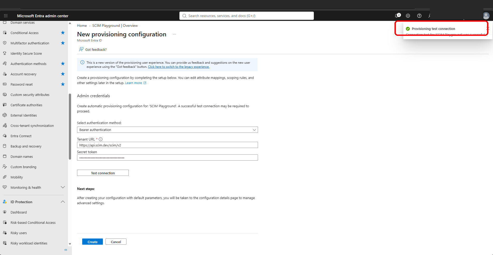
*Entra connected to the scim.dev SCIM endpoint and the connection test passed.*

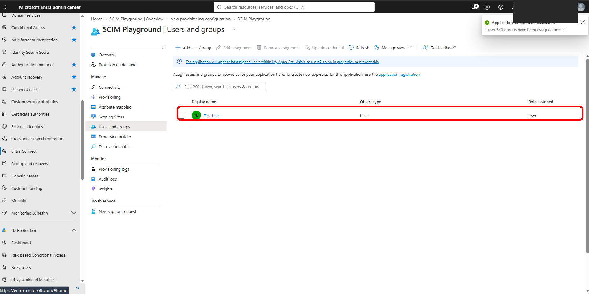
*Assigned Test User to the SCIM Playground enterprise app for provisioning.*

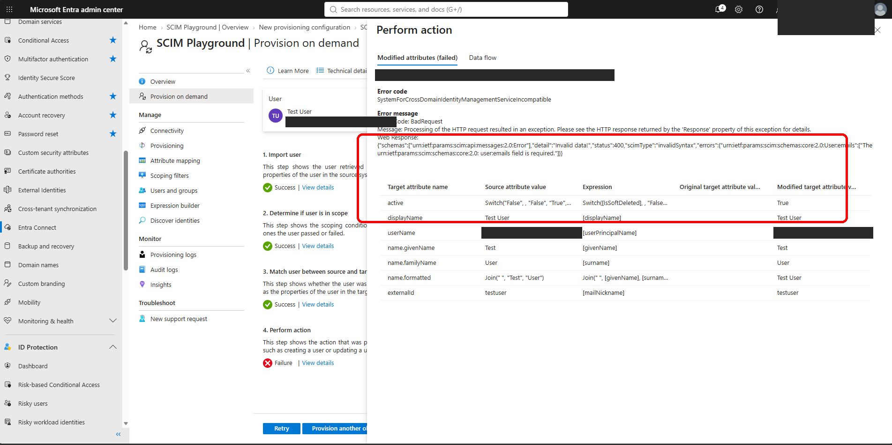
*Error I hit: provisioning failed because the app requires an email attribute.*

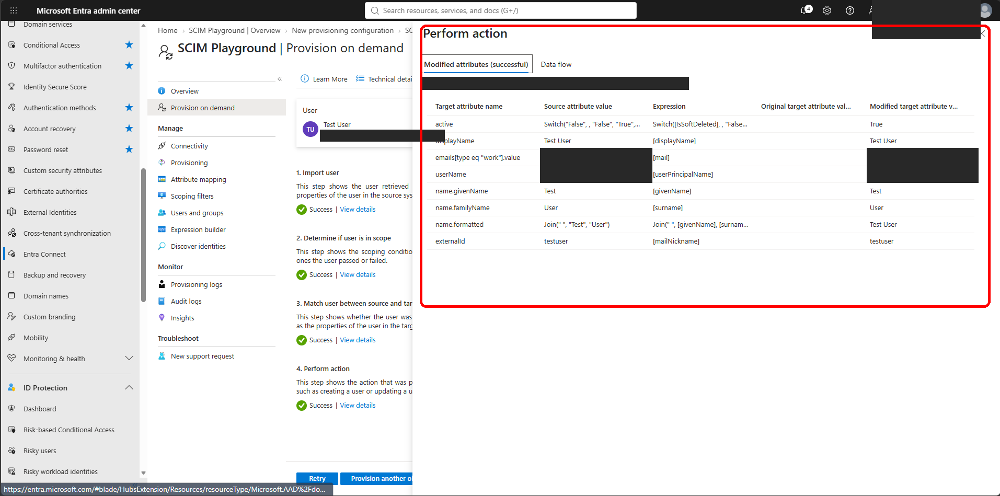
*After adding the missing email to Test User, the user was created in the SCIM app.*

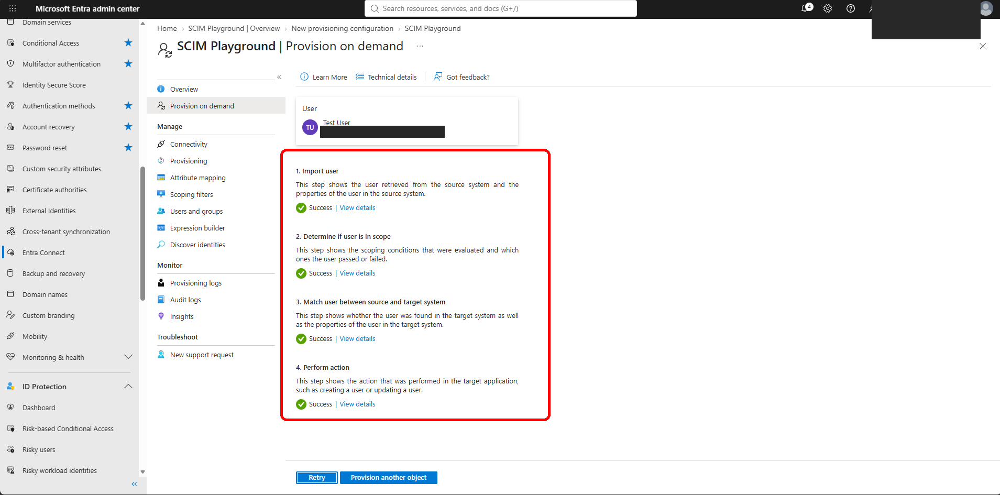
*Provision on demand passed all four steps for Test User.*

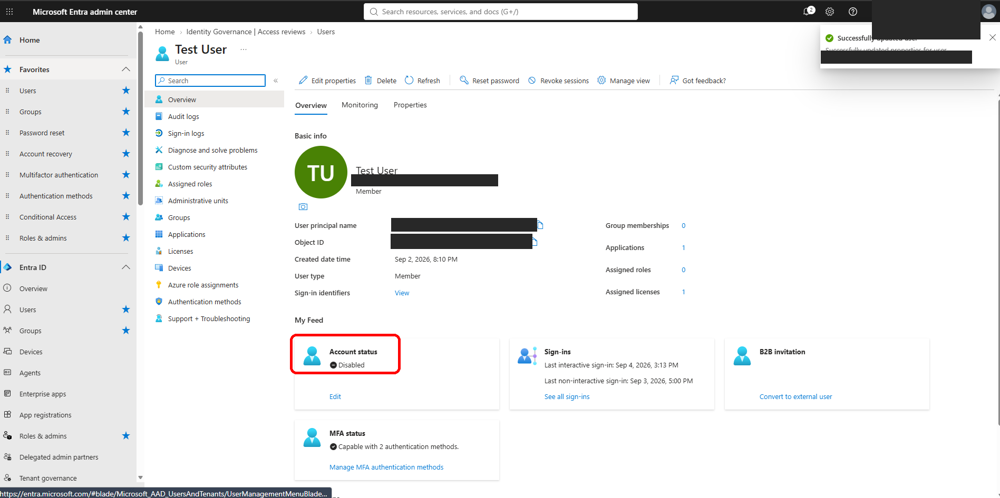
*Leaver step: Test User account disabled in Entra ID.*

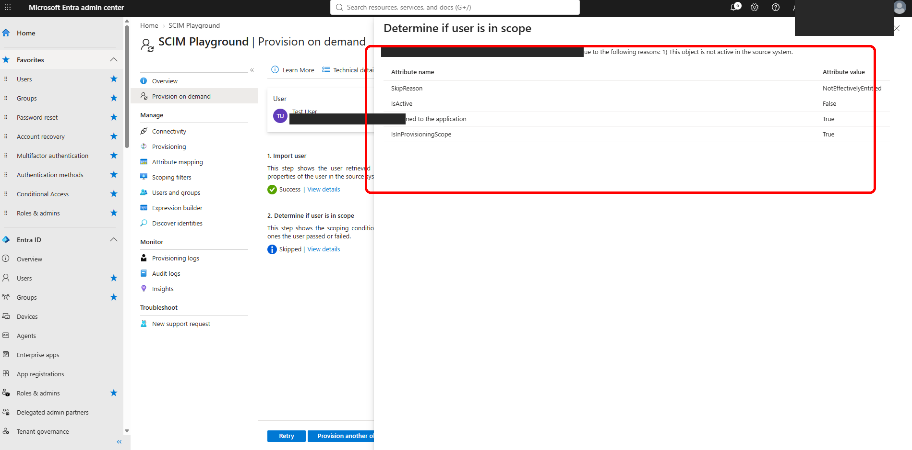
*Entra marked the leaver inactive; app-side deactivation proven only on Entra's side.*

## Environment

| Item | Value |
| --- | --- |
| Identity provider | Microsoft Entra ID (lab tenant) |
| Target app | SCIM Playground at [scim.dev](https://scim.dev) (free test server) |
| Tenant URL | `https://api.scim.dev/scim/v2` |
| Auth | Bearer token (blacked out / masked) |
| Test user | Test User |

## What broke / issues I fixed

- **First provision failed at step 4 (Perform action):** `400 invalidSyntax: ...User:emails field is required`. Test User had no email. I added one and retried, and the user was created.

## Gaps

- **App-side deactivation is not shown.** The leaver run returned Skipped, and scim.dev's free playground resets its data. Proven: the disable on the Entra side only (`IsActive: False`, still assigned). This is not an end-to-end deprovisioning demo.
- Blacked out in screenshots: tenant name, account email/UPNs, app/object/job IDs, URL bars, and the scim.dev token.

Full proof (all screenshots)

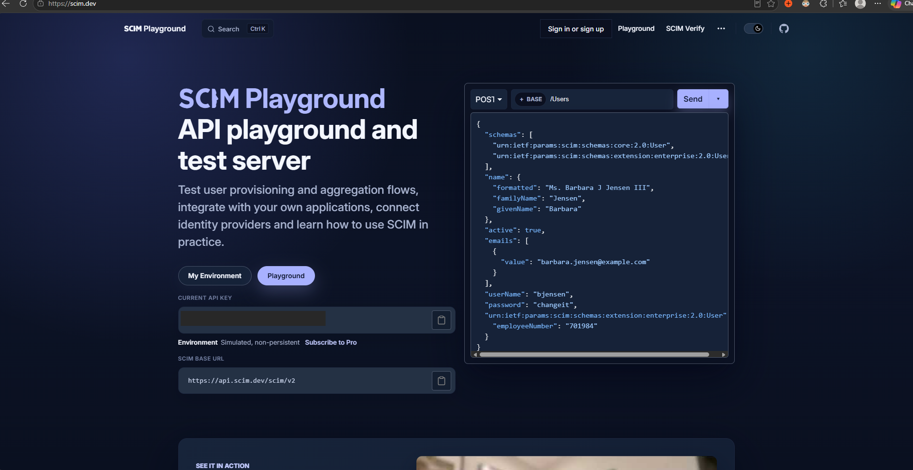

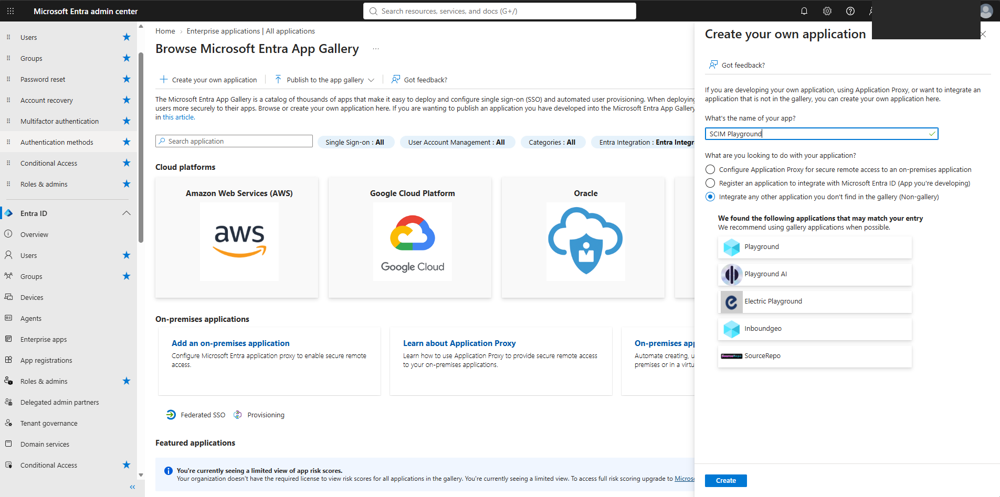

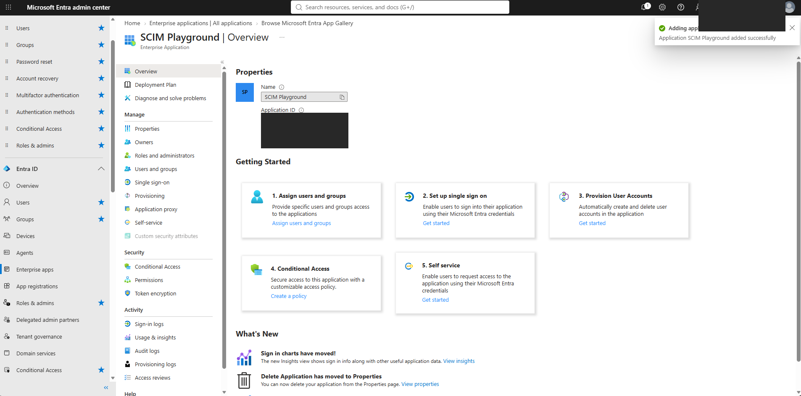

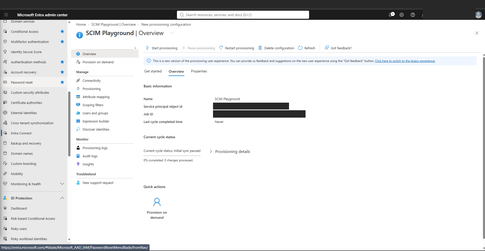

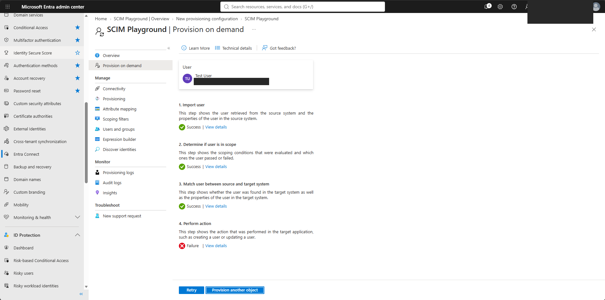

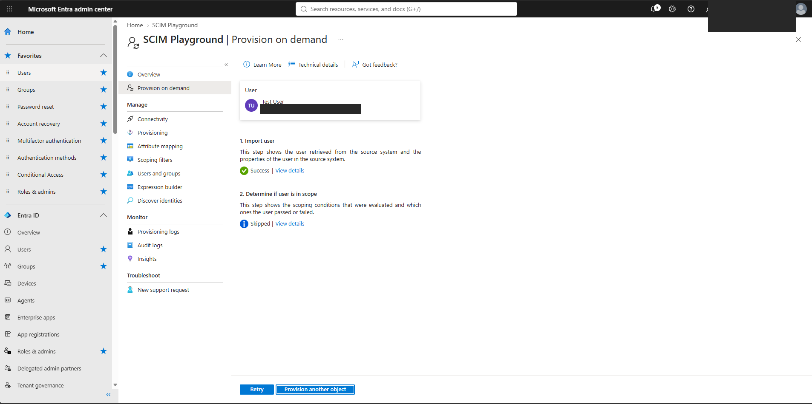

